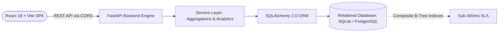

# ACME Salary Intelligence — Enterprise HR Compensation Platform

[]()
[]()
[]()
[]()
[]()
[]()
[]()

> A full-stack compensation intelligence application built for the fictional global organization **ACME**, managing **10,000 employees** across 7 countries and 7 currencies. Built for the hiring assessment to demonstrate product thinking, engineering fundamentals, relational modeling, sub-second query performance at scale, and UX polish.

---

## 1. Product Overview

HR managers and People Ops leadership in multi-national enterprises face a critical challenge: evaluating payroll and compensation parity across distributed workforces without succumbing to distorted currency conversions, sluggish data grids, or compliance violations.

**ACME Salary Intelligence** solves this problem by providing:
- **Strict ISO Currency Isolation**: Eliminates deceptive cross-currency sums by isolating USD, EUR, GBP, JPY, CAD, INR, and AUD compensation portfolios.
- **Sub-300ms Performance at 10,000 Records**: Windowed server-side pagination and SQL pushdown group-by aggregations prevent browser memory exhaustion.
- **Audit-Ready Temporal Compensation**: Non-destructive salary adjustments using `effective_from` and `effective_to` timelines.
- **Structured Compensation Questions Hub**: Parameterized, deterministic query templates answering high-frequency executive compensation inquiries without risky LLM-to-SQL hallucinations.
- **Sanitized CSV Data Export**: Filtered export with formula injection mitigation (`=`, `+`, `-`, `@` neutralization).

---

## 2. Key Features

### Executive Compensation Dashboard
- Real-time headcount KPIs (10,000 total employees, 7 departments, 7 countries).
- Multi-currency annual payroll portfolio breakdown cards (USD, EUR, GBP, JPY, CAD, INR, AUD).
- Interactive SVG charts: Headcount by Country, Headcount by Department, and Cross-Department Compensation comparisons.

### Employee Directory & Management
- Windowed data table with server-side pagination (25 records/page).
- Real-time multi-facet filtering (Country, Department, Employment Status, Currency) with a single-click "Clear Filters" action.
- Server-side text search across employee names and IDs.
- Comprehensive Employee Profile modal and Edit Compensation modal with temporal validity preservation.
- Soft deactivation (marks status as `terminated` rather than permanent database deletion).
- Add Employee modal with coherent country-to-currency auto-suggestions.

### Compensation Analytics
- Multi-dimensional breakdown by Department, Country, Job Title, or Employment Status.
- Exact mean and median salary calculations with statistical spread (min, max, spread range).
- Currency-scoped Recharts bar charts visualizing Mean vs. Median compensation.

### Structured Compensation Questions
Predefined parameterized query templates answering core HR inquiries:
1. *How many active employees are there in each country?*
2. *Which department has the highest median salary?*
3. *What is the salary distribution by department?*
4. *What are the average and median salaries for a selected country and currency?*
5. *Which departments have the highest total payroll?*
6. *How many employees earn above a specified salary threshold in a selected currency?*
7. *How do salary ranges vary by job title?*

---

## 3. Architecture & Tech Stack



### Technology Matrix
| Layer | Technologies Selected | Rationale / Key Library |
| :--- | :--- | :--- |
| **Frontend** | React 18, TypeScript, Vite, Material UI (MUI) | Strict type checking, responsive design tokens, accessible components |
| **State & Data** | TanStack Query v5, Recharts | Server-state caching, background revalidation, responsive SVG data visualization |
| **Backend** | Python 3.11+, FastAPI, Pydantic v2 | High-throughput asynchronous routing, strict schema contract validation |
| **ORM & DB** | SQLAlchemy 2.0, Alembic, SQLite / PostgreSQL | Normalized 3NF modeling, temporal compensation validity, declarative migrations |
| **Testing** | Pytest, Vitest, React Testing Library | 16 backend integration/benchmark tests, 13 frontend component/formatter tests |
| **Quality** | Ruff, ESLint, TypeScript Compiler (`tsc`) | Fast formatting, static linting, 0 type errors |

---

## 4. Local Quickstart Guide

### Prerequisites
- **Node.js**: v18.0.0 or higher (v20+ recommended)
- **npm**: v9.0.0 or higher
- **Python**: v3.11 or higher (tested on Python 3.11, 3.12, 3.14)
- **Git**

### 1. Clone & Setup Configuration
```bash
git clone https://github.com/acme/salary-intelligence.git
cd salary-intelligence
cp .env.example .env
```

### 2. Backend Setup & Seeding 10,000 Employees
```bash
cd backend

# Create and activate virtual environment
python3 -m venv .venv
source .venv/bin/activate  # On Windows: .venv\Scripts\activate

# Install dependencies
pip install -r requirements.txt

# Run database migrations
alembic upgrade head

# Deterministically seed 10,000 employees (completes in ~7 seconds)
python seed.py

# Start the FastAPI development server
uvicorn app.main:app --reload --port 8000
```
Backend API will be live at: **`http://localhost:8000`**  
Interactive Swagger OpenAPI Docs: **`http://localhost:8000/docs`**

### 3. Frontend Setup & Launch
In a new terminal window:
```bash
cd frontend

# Install dependencies
npm install

# Start the Vite development server
npm run dev
```
Frontend will be live at: **`http://localhost:5173`**

---

## 5. Verification & Quality Gates

Run the automated test suites, linting, and production builds:

```bash
# 1. Run Backend Pytest Suite (16 tests, including 10k performance benchmarks):
cd backend && .venv/bin/pytest tests/ -v

# 2. Run Backend Linter (Ruff):
cd backend && .venv/bin/ruff check app tests

# 3. Run Frontend Vitest Suite (13 tests):
cd frontend && npm test

# 4. Run Frontend TypeScript Type Check:
cd frontend && npx tsc --noEmit

# 5. Run Production Frontend Build:
cd frontend && npm run build
```

---

## 6. Project Documentation Index

Comprehensive engineering documents are located in the `docs/` directory:

| Document | Purpose / Content |
| :--- | :--- |
| [docs/requirements.md](docs/requirements.md) | Product Requirements Document (PRD), HR persona, success criteria. |
| [docs/architecture.md](docs/architecture.md) | System architecture, component responsibilities, data flow, ER diagrams. |
| [docs/decisions.md](docs/decisions.md) | Architecture Decision Records (ADR-001 through ADR-007). |
| [docs/testing.md](docs/testing.md) | Testing strategy, test inventory, execution logs, and benchmark SLAs. |
| [docs/deployment.md](docs/deployment.md) | Production deployment guide for Vercel, Render, and PostgreSQL. |
| [docs/ai-development-log.md](docs/ai-development-log.md) | Engineering record of prompts, human decisions, discovered bugs, and fixes. |
| [docs/known-limitations.md](docs/known-limitations.md) | Assessment demo boundaries, authentication scope, and future roadmap. |

---

## 7. Authentication Note for Reviewers

The demo application intentionally runs in an **unauthenticated demonstration mode**. Reviewers can immediately explore the 10,000-employee dataset, test all filters, edit records, and execute analytical queries without needing account credentials.

For details on how enterprise SAML/OIDC SSO, Role-Based Access Control (RBAC), and Row-Level Security (RLS) are designed for production deployment, see [docs/known-limitations.md](docs/known-limitations.md).
