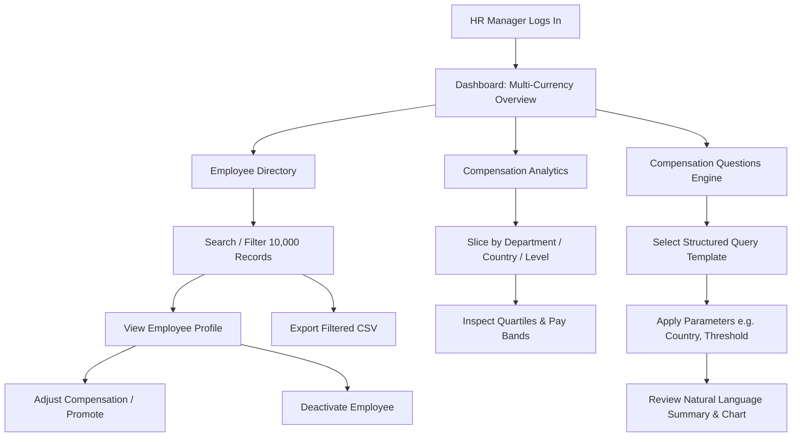

# ACME Salary Intelligence — Product Requirements Document (PRD)

**Document Version:** 1.0.0  
**Status:** Approved for Implementation  
**Target Organization:** ACME Global Enterprise (10,000 Employees across 7 Countries)

---

## 1. Problem Statement

ACME employs 10,000 personnel distributed globally across North America, Europe, and Asia-Pacific. The HR and Total Rewards teams currently rely on disjointed spreadsheets and regional HRIS extracts to analyze employee compensation. This causes three critical operational failures:
1. **Misleading Financial Aggregations:** Regional currencies (USD, EUR, GBP, JPY, CAD, AUD, INR) are frequently summed naively, generating invalid global payroll figures.
2. **Performance Bottlenecks:** Standard desktop spreadsheets freeze and crash when filtering, sorting, or aggregating 10,000 detailed records.
3. **Inefficient Executive Reporting:** Routine compensation inquiries from leadership (e.g., department salary distributions, gender/regional parity, high-earner counts) require manual, error-prone data wrangling rather than instantaneous answers.
4. **Data Integrity & Audit Risks:** Lack of relational constraints allows duplicate employee numbers, unvalidated salary updates, and destructive permanent deletions instead of auditable deactivations.

---

## 2. Primary User Persona

* **Persona:** Elena Vance, Global Total Rewards & HR Operations Director at ACME.
* **Role & Responsibilities:** Oversees headcount planning, annual compensation reviews, equity audits, and executive payroll reporting across all departments and subsidiaries.
* **Pain Points:** Needs immediate answers to ad-hoc executive questions; requires server-side responsiveness across 10,000 records; demands mathematically accurate, currency-safe calculations with zero floating-point rounding errors.

---

## 3. Product Goal & Measurable Success Criteria

* **Product Goal:** Deliver a high-performance, responsive B2B SaaS web application that provides unified salary intelligence, auditable employee lifecycle management, and deterministic compensation inquiry capabilities over 10,000 employee records.
* **Measurable Success Criteria:**
  * **P95 Latency < 250ms** for server-paginated employee list (50 records/page) and faceted search.
  * **P95 Latency < 400ms** for database-level aggregation queries over 10,000 rows.
  * **100% Currency Isolation:** Zero un-normalized cross-currency summing; clear currency-segmented or explicitly pegged metrics.
  * **Zero Precision Loss:** Use of fixed-point Decimal arithmetic for all salary figures.
  * **100% Test Determinism:** Automated test suite with reproducible seed verification.

---

## 4. Scope

### In-Scope Features
1. **Executive Compensation Dashboard:** Real-time metrics (headcount, currency-segmented annual payroll, mean/median salary, department and country distributions).
2. **Server-Paginated Employee Directory:** 10,000-record data table with server-side search, multi-column sorting, facet filters (country, department, status, currency), and debounced search.
3. **Employee Lifecycle & Compensation Management:** Detailed profile view, employee onboarding modal, salary adjustment with historical record preservation, and reversible deactivation (soft delete).
4. **Compensation Analytics Hub:** Aggregated statistical breakdowns (mean, median, min, max, quartiles/distributions) grouped by country, department, and job title.
5. **Structured Compensation Questions Engine:** Predefined, parameterized query templates answering critical executive questions with plain-English summaries, data tables, and charts.
6. **Safe CSV Export:** Streamed or bounded export of filtered employee datasets with spreadsheet formula injection protection.
7. **System & Operational Transparency:** Settings/About panel detailing demo dataset properties, exchange rate benchmarks, and system health status.

### Explicitly Out-of-Scope (and Rationale)
* **Live Bank Rails / Payroll Disbursement (ACH/SEPA):** ACME Salary Intelligence is an analytical and operational planning platform, not an ERP payment gateway.
* **Complex Multi-Jurisdiction Tax Withholding Engine:** Tax rules vary across thousands of local municipalities and change frequently; tax calculation is deferred to specialized payroll processors.
* **Multi-Tenant Architecture:** Built specifically for ACME enterprise internal operations.
* **Arbitrary Natural Language-to-SQL (NL2SQL):** Unconstrained LLM-to-SQL execution introduces severe SQL injection, schema hallucination, and nondeterministic risks. Predefined, parameterized query templates guarantee 100% correctness.
* **Heavy Microservices / Distributed Message Queues:** Unnecessary operational overhead for a dataset of 10,000 records; a clean modular monolith with indexed relational storage is orders of magnitude faster and simpler to maintain.

---

## 5. Important Assumptions & Business Rules

1. **Deterministic Seed Dataset:** Exactly 10,000 employees distributed realistically across 7 countries:
   * United States (`US` / `USD`), United Kingdom (`GB` / `GBP`), Germany (`DE` / `EUR`), Japan (`JP` / `JPY`), Canada (`CA` / `CAD`), Australia (`AU` / `AUD`), India (`IN` / `INR`).
2. **Currency Integrity Rule:** Currencies must never be added together without explicit normalization. The dashboard displays currency-specific totals alongside an explicit USD-normalized benchmark using fixed reference exchange rates.
3. **Compensation History:** Each salary change closes the prior compensation record (`effective_to = now()`) and inserts a new active record (`effective_to IS NULL`). Overlapping active periods are prohibited by schema design.
4. **Soft Deactivation:** Terminating or deactivating an employee updates `employment_status` (`INACTIVE` / `TERMINATED`) and sets `updated_at`, preserving all historical compensation records.
5. **Monetary Precision:** All salary columns use `NUMERIC(14, 2)` (or `INTEGER` for zero-decimal currencies like JPY). Floating-point `FLOAT`/`REAL` types are strictly prohibited.

---

## 6. Core User Workflows

---

## 7. Non-Functional Requirements

* **Performance:** Database indexes on `(department_id, country_code, employment_status)`, `last_name`, and `hire_date`. Pagination queries must never perform full-table sequential scans.
* **Data Integrity:** Foreign keys on `compensation.employee_id -> employee.id`, unique index on `employee.employee_number` and `employee.email`.
* **Security & Sanitization:**
  * CORS restricted to application origin.
  * Parameterized SQL queries via SQLAlchemy ORM (zero string concatenation).
  * CSV export sanitizes leading formula triggers (`=`, `+`, `-`, `@`).
  * Sensitive internal stack traces suppressed in production API responses.
* **Usability & Accessibility:** Material-UI design tokens, WCAG AA color contrast, explicit ISO currency formatting (e.g., `$120,000 USD`, `£85,000 GBP`, `¥11,500,000 JPY`).

---

## 8. Acceptance Criteria

1. [x] **PRD Approval:** This document committed to Git prior to application scaffolding.
2. [ ] **Seed Dataset:** Exactly 10,000 valid, deterministic records seeded and verified via automated test.
3. [ ] **Backend API:** FastAPI `/api/v1` serving health, dashboard, paginated employees, CRUD mutations, analytics aggregations, CSV export, and compensation question endpoints.
4. [ ] **Frontend Application:** React + TypeScript + MUI interface with zero browser freezing, responsive state management, and real-time backend synchronization.
5. [ ] **Currency Semantics:** No accidental mixing of disparate currency denominations in UI or API responses.
6. [ ] **Test Coverage:** Automated unit, integration, and performance benchmark tests passing in CI/test runner.
7. [ ] **Documentation & Deployment:** Full architecture guide, decision records, testing manual, and deployment configuration verified.
